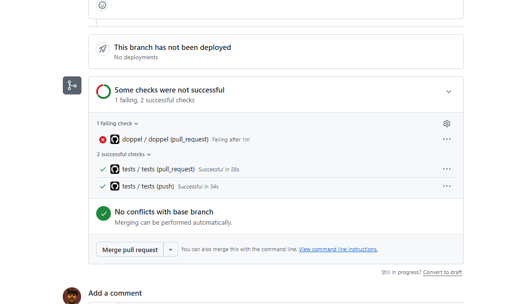
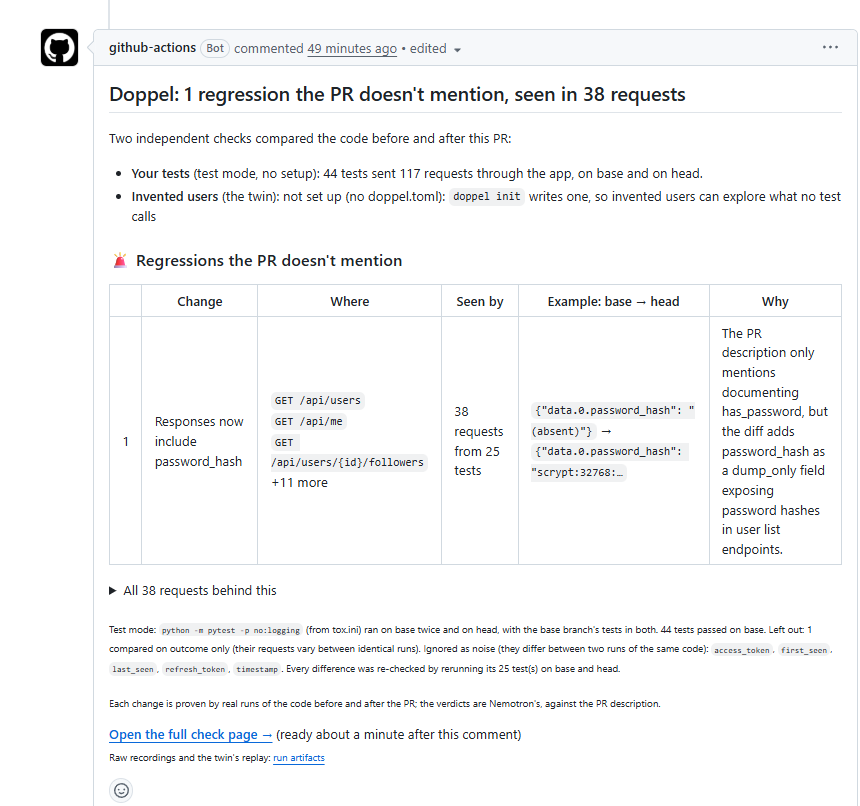
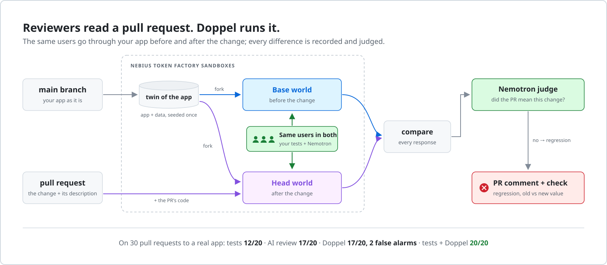
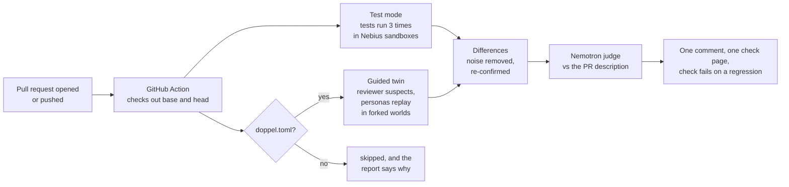

<div align="center">

# Doppel

**Tests check what someone thought of. Reviewers read the diff. Doppel runs it.**

A GitHub check for Python web APIs (Flask, Django, FastAPI). It runs every pull request against the main
branch in Nebius sandboxes, sends the same requests through both, and proves each regression with the
request, the old answer and the new answer.

[](https://github.com/Maukthik/doppel/actions/workflows/tests.yml)
[](LICENSE)


[Quickstart](#put-it-on-your-pull-requests) · [**Try it on any PR**](https://maukthik.github.io/doppel-try/) · [Live demo PR](https://github.com/Maukthik/doppel-demo/pull/1) · [How it works](#how-it-works) · [Results](#results) · [Replay site](https://maukthik.github.io/doppel/) · [Changelog](CHANGELOG.md)

*Nebius x NVIDIA Global AI Hackathon · Coding and Agentic Engineering track*

</div>

<p align="center">
  <a href="https://github.com/Maukthik/doppel-demo/pull/1"></a>
  <a href="https://github.com/Maukthik/doppel-demo/pull/1"></a>
</p>
<p align="center"><sub>A live pull request on a fresh repo, zero setup: all 44 tests pass, Doppel fails the check and shows the leak in 38 requests. <a href="https://github.com/Maukthik/doppel-demo/pull/1">Open the PR</a></sub></p>

## Contents

**Use it**
[The problem](#one-line-leaked-every-password-hash) ·
[Try it on any PR](#try-it-on-any-public-pull-request) ·
[Put it on your pull requests](#put-it-on-your-pull-requests) ·
[What you get](#what-you-get-on-every-pull-request) ·
[Try it offline](#try-it-in-one-minute-offline-no-keys) ·
[Test it end to end](TESTING.md)

**Understand it**
[How it works](#how-it-works) ·
[Test mode](#test-mode-your-own-tests-as-the-users) ·
[The guided twin](#the-guided-twin-invented-users-in-forked-worlds) ·
[The judge](#the-judge-intended-regression-or-needs-a-human) ·
[One check, one verdict](#one-check-one-verdict) ·
[Setting up the twin](#setting-up-the-twin) ·
[Trust and data](#trust-and-data) ·
[Results](#results)

**Reference**
[Commands](#commands) ·
[`doppel.toml`](#doppeltoml) ·
[Personas](#the-persona-format) ·
[Action](#the-github-action) ·
[Output files](#output-files) ·
[Environment](#environment-variables-and-models) ·
[Repository map](#repository-map) ·
[Try Doppel internals](#how-try-doppel-works) ·
[Develop](#develop) ·
[Limits](#limits) ·
[Roadmap](#roadmap)

---

## One line leaked every password hash

A pull request titled *"Describe has_password in the API schema"* changed one line in
[microblog-api](https://github.com/miguelgrinberg/microblog-api), a well-tested open-source Flask app.

| | Verdict |
|---|---|
| The app's 44 tests | ✅ all pass |
| AI code review (Nemotron 3 Ultra, full source + diff) | ✅ "safe" |
| **Doppel** | ❌ **regression**: `GET /api/users` answers with `"password_hash": "scrypt:32768:8:1$…"` on every user object |

The tests never looked at that field, and the reviewer didn't notice what one schema line does. Doppel
didn't need to notice anything. It ran both versions, saw the field appear and showed the evidence.

You can open this one: [doppel-demo#1](https://github.com/Maukthik/doppel-demo/pull/1) is that PR on a fresh
repo with one workflow file and no other setup. Doppel ran the app's own tests on both versions in about a
minute and flagged the same 38 requests on two runs ([recorded results](bench/results/demo-pr)).

That is the whole idea. A test suite checks the values someone thought to assert. A reviewer reads the
diff and guesses what it does. Doppel runs the code from before and after the change, records every
response, and shows what changed. An AI judge then compares each change with what the PR says it does, so
only the changes nobody mentioned land in front of the reviewer.

## Try it on any public pull request

Paste a link on the **[Try page](https://maukthik.github.io/doppel-try/)**. It opens a GitHub issue on
[doppel-try](https://github.com/Maukthik/doppel-try); a workflow there runs `doppel check` on the PR in Nebius
sandboxes and replies on the issue in 1 to 5 minutes, with a link to the check page. Nothing to install.
The page runs test mode only, for public repos, with a daily cap. [How it works](#how-try-doppel-works).

## Put it on your pull requests

1. **Get a Nebius Token Factory API key.** On the [API keys page](https://tokenfactory.nebius.com/project/api-keys),
   create a key in the project that will run the sandboxes. Save it right away: it can't be shown again.
2. **Copy the project ID** from **Project settings** in Token Factory, under the project name.
3. **Add both to your repo as secrets**: *Settings → Secrets and variables → Actions → New repository secret*,
   named `NEBIUS_API_KEY` and `NEBIUS_PROJECT_ID`.
4. **Add the workflow** as `.github/workflows/doppel.yml`:

   ```yaml
   name: doppel
   on: pull_request
   jobs:
     doppel:
       runs-on: ubuntu-latest
       permissions:
         contents: write        # only to publish the check page (see "Data and permissions")
         pull-requests: write   # to post the comment
       steps:
         - uses: Maukthik/doppel@v1
           with:
             nebius-api-key: ${{ secrets.NEBIUS_API_KEY }}
             nebius-project-id: ${{ secrets.NEBIUS_PROJECT_ID }}
   ```

5. **Open a pull request.** Test mode needs nothing else: Doppel finds the test command and the install in
   `tox.ini`, your CI workflow, a Makefile or a noxfile. With a `doppel.toml` ([below](#setting-up-the-twin)),
   the guided twin runs too.

If the key works but no sandbox starts, the project may not have Sandboxes enabled yet:
[Nebius's access guide](https://docs.tokenfactory.nebius.com/sandboxes/start/set-up-access) shows how to check.
Every input of the Action is listed under [The GitHub Action](#the-github-action).

### What you get on every pull request

- **One comment, updated on each push.** The regressions the PR doesn't mention come first, each with the
  request, the old value, the new value and the reason. Then what needs a person, then the reviewer's
  suspicions as the twin checked them. Changes the PR announces are folded away.
- **A check that fails on a regression.** If a flagged change is what you want, a maintainer adds the label
  `doppel: accepted` and re-runs the check: it passes, and the comment keeps the findings. Adding labels
  takes triage access, so an outside contributor can't wave their own PR through, and the PR's timeline shows
  who added it.
- **No false red when Doppel can't run.** If the app won't install or no test runs, the check passes with a
  warning and the comment says why (`fail-on-error: true` makes it fail instead). A pull request that breaks
  the app is different: a head that no longer starts counts as a regression.
- **A check page** with every request behind every finding, on GitHub Pages or in the run's artifacts.
- **A pytest file** (CLI, `--tests-out`) with one test per regression, asserting what the old code answered.

[`examples/demo-repo`](examples/demo-repo) sets up a repo where you can watch a red comment turn green.

## Try it in one minute (offline, no keys)

```bash
git clone https://github.com/Maukthik/doppel
cd doppel
python -m venv .venv
source .venv/bin/activate        # Windows PowerShell: .venv\Scripts\Activate.ps1
pip install -e ".[dev]"
doppel run --base examples/shop/base --head examples/shop/head --personas examples/shop/personas.json
```

The shop's PR ([`examples/shop/PR.md`](examples/shop/PR.md)) says it only adds an `in_stock` flag. Doppel
finds two more changes the PR doesn't mention: coupon orders now cost more, and an order for quantity 0 is
accepted instead of rejected. You should see `## Doppel: 6 behavior changes` in a few seconds: those three
changes, one row per request that showed one.

With a Nebius key in `.env` (copy [`.env.example`](.env.example)), the same run happens in sandboxes, with
invented users and the judge:

```bash
pip install -e ".[nebius,dev]"
doppel run --backend nebius --base examples/shop/base --head examples/shop/head \
  --personas examples/shop/personas.json --pr examples/shop/PR.md --tests-out test_regressions.py
```

To test everything yourself, level by level, from this example to the password-hash leak on a real app
and re-deriving the benchmark's numbers: [TESTING.md](TESTING.md).

To use the CLI without cloning: `pip install "doppel-check[nebius] @ git+https://github.com/Maukthik/doppel@v1"`.
The package is named `doppel-check` because `doppel` on PyPI is an unrelated project; the command is `doppel`.

---

## How it works

<picture>
  <source media="(prefers-color-scheme: dark)" srcset="docs/doppel-architecture-dark.svg">
  
</picture>

Doppel has **two ways to exercise the app** and **one way to decide what a difference means**:

| | **Test mode** | **Guided twin** |
|---|---|---|
| Who the users are | Your own test suite, recorded request by request | Personas and probes written by Nemotron |
| Setup | None: the commands come from `tox.ini`, your CI workflow, a Makefile or a noxfile | A `doppel.toml`, written by `doppel init` |
| Where the app runs | The test process, inside Nebius sandboxes | A live server, in forked Nebius sandbox checkpoints |
| Catches | Everything that changed in responses your tests already produce, including fields no assertion checks | Paths no test calls at all |
| Frameworks | Flask/Werkzeug, Django (+ DRF), FastAPI/Starlette, live-server tests via `requests`/`httpx` | Any HTTP + JSON app |

Both feed the same **judge** (NVIDIA Nemotron 3 Ultra), which labels every distinct difference *intended*,
*regression* or *needs a human* by checking it against the PR description. `doppel check` runs both modes in
parallel and merges them into one report and one exit code.

What happens on one pull request, end to end:



### Test mode: your own tests as the users

Test mode ([`traffic.py`](src/doppel/traffic.py), [`traffic_recorder.py`](src/doppel/traffic_recorder.py),
[`setup_plan.py`](src/doppel/setup_plan.py)) needs no setup, because the app's tests already know how to build
the app, its database and its logged-in users.

1. **Find how the project tests itself.** [`setup_plan.py`](src/doppel/setup_plan.py) builds a *setup plan*:
   the test command, the install steps, system packages, environment, working folder and services, each with
   where it came from. Sources, most trusted first: `doppel.toml [tests]`, `tox.ini [testenv]`, the CI job that
   actually runs the tests (the workflow YAML is parsed and one job is chosen, so lint-job installs never mix
   in), then a test script, the Makefile `test` target, a noxfile, `manage.py`, or a tests folder. When that
   source installs only tools, the project's own dependencies come first: requirements files, `pyproject`
   dependencies and test extras, PEP 735 dependency groups, Poetry, Pipfile. `tox.ini` with `skipsdist` is
   respected, and tox's own placeholders are filled in as tox would with no arguments (`{posargs:tests}` →
   `tests`, `{posargs}` → nothing, `{toxinidir}` → the repo root).
2. **Build three worlds in Nebius sandboxes.**

   | World | Code | Why |
   |---|---|---|
   | **A, base** | the commit the PR started from | the known-good behavior |
   | **A′, base again** | the same code, run a second time | whatever differs between A and A′ is noise |
   | **B, head** | the PR's code, **with the base branch's tests** | the change |

   Head runs the base branch's tests, so a PR can't hide a change by editing the test that shows it; tests
   the PR adds have no baseline and are left out. Every world runs with fixed seeds and order
   (`PYTHONHASHSEED`, no random test order, UTC); a project's own `PYTEST_ADDOPTS` is added to Doppel's
   options, never replacing them, and `PYTHONHASHSEED=random` is ignored. Large pytest suites (30+ test files) are split by file
   across up to 8 sandboxes per world, so tests sharing a module's setup stay together.
3. **Record every request the tests send.** [`traffic_recorder.py`](src/doppel/traffic_recorder.py) is loaded
   into the test process through a generated `sitecustomize.py` and as a pytest plugin. It patches the
   framework's test client only if the app imports it (`werkzeug.test.Client`, `django.test.Client` and DRF's
   `APIClient`, Starlette's `TestClient` transport) and writes every request, response, status and timing,
   plus how each test ended, to one JSONL file per process. It is standard library only, and a recorder
   failure is logged, never raised, so it can't change a test's outcome.
4. **Remove noise.** A versus A′: tests whose outcome differs are *flaky* and excluded; fields that differ are
   *noisy* and ignored (`access_token`, `timestamp`…); tests whose requests differ are compared on their
   outcome only.
5. **Compare A with B, field by field.** Each difference becomes a *finding*: a changed body field (with its
   dotted path, such as `data.0.password_hash (added)`), a changed status, a new error, a request only one side
   made, or a test that passed on base and fails on head.
6. **Confirm.** Every difference is re-checked by running the tests involved again on base and head (up to 200
   tests). One that doesn't happen again is dropped as noise.

Safeguards, so a broken environment never turns into a verdict: if no test runs on base, collection fails, or
more than half the tests fail on unchanged code, test mode stops and shows the test runner's own output.
Tests that fail on base are excluded and listed. Tests that ran but sent no request through a recognised
test client are reported as such. When the tests fail because they can't reach PostgreSQL, Doppel installs it
in the sandbox image and starts it before every test job ([`services.py`](src/doppel/services.py)).

### The guided twin: invented users in forked worlds

The twin ([`backends/nebius.py`](src/doppel/backends/nebius.py), [`runner.py`](src/doppel/runner.py)) runs the
app as a live server and explores what no test calls. It needs a [`doppel.toml`](#doppeltoml).

**1. Build the twin once, then fork it.** Nebius Token Factory Sandboxes (ConTree) can checkpoint a running
sandbox and fork throwaway copies from it in about 1.4 seconds:

```
image ─ upload base code ─ install ─ seed ──────────────────► SEEDED
SEEDED ─ migrate ───────────────────────────────────────────► BASE world
SEEDED ─ overlay the PR's code ─ install ─ migrate ─────────► HEAD world
```

Both worlds start from the same seeded data, so any difference comes from the code. The code goes up as one
archive ([`sandbox.py`](src/doppel/sandbox.py)): sending thousands of files one by one broke the connection
pool on large apps. At most 12 sandboxes start at once, dropped connections are retried, and an
infrastructure failure is reported as such, never as a result about the app.

**2. Write the users.** NVIDIA Nemotron 3.5 Lightning reads the app's source (up to 400k characters) and the
diff, and writes personas ([`personas.py`](src/doppel/personas.py)): ordinary users, power users, and careless
users who send zero, negative, empty or unknown values. About half walk through the code the PR changed.
Personas are written once and replayed identically in both worlds. In the Action they come from the base
branch (`doppel-personas.json`), so a PR can't choose its own testers; if the file isn't there, Nemotron
writes them for that PR.

**3. Let a reviewer suspect** (review-guided mode, [`suspects.py`](src/doppel/suspects.py)). Nemotron 3 Ultra
reads the PR description, the diff and the source, and lists every behavior change it suspects the PR doesn't
announce, with the **exact inputs** that would show each one. For each suspicion Doppel writes a *probe*
persona that sends those inputs.

**4. Rehearse and repair** ([`rehearsal.py`](src/doppel/rehearsal.py)). Every persona is replayed once on the
base world first. A persona that mostly gets 401, 403, 404 or 405 sees the same error in both worlds and can
never find a regression, so it goes back to Nemotron with what the app answered and comes back fixed.
A probe goes back as soon as one request couldn't have reached the code (a 405, an unfilled `{placeholder}`,
no answer at all). Deliberately bad input from careless users is kept. If the spec has a `[personas.login]`
step, personas that never log in get it added.

**5. Replay in isolation.** Every persona runs in its own throwaway fork of each world, all in parallel (up to
40 at once), so one user's order or deleted post can't leak into another user's results. Inside the sandbox,
[`runner.py`](src/doppel/runner.py) (standard library only) starts from the world's state, replays the
persona's steps against the app on `$PORT`, keeps cookies like a browser, sends CSRF tokens back, and prints
the recording.

**6. Check reach** ([`reach.py`](src/doppel/reach.py)). A tracer on the app's `PYTHONPATH` records the first
time each changed line runs, in head (changed or added lines) and base (changed or removed lines). The report
says which changed functions some user reached and which none did, so "no differences" can be told apart from
"never ran the change".

**7. Compare** ([`diff.py`](src/doppel/diff.py)). Doppel lines up every step in the two worlds and flags new
errors, status changes, changed JSON values (naming the exact field) and large slowdowns (default: 2× slower
and at least 50 ms). Keys listed in `[diff] ignore`, read from the base branch, are skipped. A persona that ran
on base but broke on head (the app no longer starts) is reported as the loudest regression there is.

**8. Settle the suspicions.** Each one ends up **confirmed** (the twin saw it), **refuted** (only if a probe
really sent the triggering value and both worlds answered the same) or **untested** (no probe got there).
Refuted suspicions are dropped from the comment; untested ones are said plainly.

### The judge: intended, regression or needs a human

[`judge.py`](src/doppel/judge.py) decides what each difference means. Identical changes (the same field added
on ten list items, the same change seen by several tests) are **grouped first**, so the model judges each
distinct change once and a run costs about $0.001–0.002 per judgment. A field change counts once wherever it
appears (`password_hash` added on 14 endpoints is one leak); a status change, a crash or a changed request is
grouped per route (a 500 on `/orders` and a 500 on `/users/{id}` are two changes with two verdicts).

1. **First pass, with the diff.** Nemotron 3 Ultra gets the PR description, the diff and the grouped changes
   (with base and head values) and labels each group. An *intended* label must **quote the PR description**;
   if the quote isn't really there (checked ignoring case, whitespace and Markdown), it becomes *needs a
   human*.
2. **Second pass, without the diff.** A narrow question: *is this change announced in the description?* The
   diff is left out on purpose, because with it a model can explain any change away ("the code removes the
   check, so 204 is expected"). Intent lives in the description. A change counts as intended only when this
   pass quotes the description; otherwise it is a regression, unless the first pass already sent it to a
   human for a reason of its own.
3. **Fixed rules applied after the model**, each one closing a way the judge was wrong:

   | Rule | Why |
   |---|---|
   | A slowdown is never a regression on its own: it goes to a human | one timing sample in a shared sandbox is not proof |
   | A change to a field that looks like a secret (`password`, `secret`, `token`, `apikey`, `privatekey`, `credential`, `salt`…, also in `snake_case` and `camelCase`) is never accepted as intended: it goes to a human | a description can't excuse leaking `password_hash` |
   | A difference on a route **the PR adds** (it answered 404 or 405 before) goes to a human, not into the regressions | there was no behavior to break |
   | A change the reviewer suspected and the twin confirmed, which the judge left to a human, becomes a regression unless the description announces it | two independent signals agree |

The labels and their reasons go into the comment. `--tests-out` writes a pytest file with one test per
regression, after the reviewer's confirmed suspicions are applied: it replays the persona up to the changed
step and asserts what the base code answered (a field the base didn't have is asserted as missing).

### One check, one verdict

[`check.py`](src/doppel/check.py) runs test mode always and the twin when the repo has a `doppel.toml`, at the
same time, judges both against the same PR description, and writes one report:

1. the headline ("1 regression the PR doesn't mention, seen in 38 requests");
2. what each mode did (tests run, requests recorded, command and where it came from, noise ignored, coverage),
   or why it couldn't run;
3. the regressions, each with where, who saw it, an example base → head and the judge's reason, and every
   request behind it;
4. what needs a human; the intended changes, folded away; the reviewer's suspicions as the twin checked them.

| Exit code | Meaning |
|---|---|
| `0` | no regressions |
| `1` | regressions found (with `--strict`) |
| `2` | neither mode could compare the two versions: never reported as "no regressions" |

In the Action, exit 2 passes the check with a warning and the reason in the comment (`fail-on-error: true`
fails it). If Doppel stops before writing a report, the comment quotes the end of its log, with the API key
and project ID replaced by `***`.

## Setting up the twin

```bash
cd your-app
doppel init      # writes doppel.toml + a seed (doppel_seed.json and/or doppel_seed.py), proven in a sandbox
doppel probe     # just print what Doppel learns: routes, database, login, models
```

`doppel init` ([`bootstrap.py`](src/doppel/bootstrap.py)) works like a new teammate on day one:

1. **Gather.** Read the repo's own setup hints (manifests, CI, Dockerfile, README) and its code.
2. **Ask the app.** [`probe.py`](src/doppel/probe.py) installs the app and runs
   [`probe_app.py`](src/doppel/probe_app.py) inside its environment, which imports it the way its framework
   would and reports what is true: routes, where the database lives, how login works, models and required
   fields, the app's own commands, and any import error with its traceback. These facts outrank the model's
   reading of the source.
3. **Draft.** Nemotron 3 Ultra writes `doppel.toml` and a seed. Seeding goes **through the front door**
   ([`frontdoor.py`](src/doppel/frontdoor.py)): `doppel_seed.json` holds ordinary HTTP steps (sign up, log in,
   create records) run once before the checkpoint, so the app itself hashes passwords and fills required
   fields.
4. **Verify.** Boot the twin with a smoke persona: seed, migrate, start, ready, log in. After the seed,
   [`dbscan.py`](src/doppel/dbscan.py) lists every SQLite database and its row counts, so a refused login is
   explained with evidence ("users=6 in /data/app.db, users=0 in /app/db.sqlite: the server reads the empty
   one").
5. **Repair.** A failure goes back to the model. If drafts keep failing, a **setup agent**
   ([`agent.py`](src/doppel/agent.py)) takes over in a live sandbox with `shell`, `read`, `serve`, `try` and
   `give_up` tools, for up to 20 steps and 4 tries. `read` reads the sandbox as it is, including files the
   agent's own commands wrote.
6. **Calibrate.** Replay invented users against the same code twice; any field that differs goes into
   `[diff] ignore`. A setup whose users reach less than 40% of the app is not accepted.
7. **Hand over** the files for a person to review and commit.

`--trace` saves every attempt, and `doppel view .doppel-trace` turns the trace into a web page with each
attempt on a five-stage rail (install, seed, start, login, users), plus the setup agent's run and every step
it took when init handed over to it. `--check` tests a hand-written setup.

## Trust and data

### A PR can't game its own check

- **Test mode runs the base branch's tests on the head**, so editing a test can't hide a change.
- **`[diff] ignore` and the personas come from the base branch**, so a PR can't add the fields it changes to the ignore list or choose its own testers.
- **The description can't excuse a secret.** A change to a field that looks like it holds one (`password_hash`, `apiKey`, `refresh_token`) always goes to a person, even when the PR description announces it.
- **Every difference is confirmed** by rerunning the tests involved on base and head. One that doesn't happen again is dropped as noise.
- **A pass has to mean something.** If the head no longer starts, that counts as a regression. If Doppel couldn't compare at all, the comment says "couldn't check this PR", never "no regressions" (the CLI exits with 2; the Action warns, or fails with `fail-on-error: true`). If a suspicion couldn't be tested, the comment says so plainly. Each report states its coverage ("the app served X of Y requests").
- **A PR that edits Doppel's own setup** (`doppel.toml`, the seed or the personas) gets a warning in its comment.
- **Accepting findings takes a maintainer.** The accept label is read live from the PR on each run, and adding labels needs triage access.

### Data and permissions

- **Where your code runs.** Doppel uploads the base and head code to Nebius Token Factory sandboxes, where it is installed and run. On the GitHub runner, Doppel only reads it.
- **What the models see.** The PR description, the diff, the app's source and the recorded responses go to NVIDIA Nemotron models on Nebius Token Factory, to write users, list suspicions and judge changes. Apart from GitHub itself, nothing is sent anywhere else; how Nebius handles the data is set by its Token Factory terms.
- **Permissions.** `pull-requests: write` posts the comment and reads the PR's labels. `contents: write` is only for publishing the check page to the `gh-pages` branch: with `publish-page: false` you can use `contents: read`, and the page stays in the run's artifacts.
- **Secrets.** The key reaches only the step that runs Doppel. When a comment has to quote Doppel's own log, the key and project ID are replaced with `***` first, since a comment isn't masked the way the job log is. The check page masks credentials, tokens and password hashes found in responses, and `doppel site` refuses to build if any credential from the environment would end up on a page.

## Results

### 30 pull requests to a real app

20 PRs carry a regression (3 of them are real upstream bug fixes, reverted) and 10 are safe.
Each PR has a description written the way authors write them: *"simplify the feed query"*, *"cheaper count for pagination"*.

| | Regressions caught | False alarms on safe PRs | Cost / PR | Time / PR |
|---|---|---|---|---|
| App's own test suite (44 tests) | 12/20 | 0/10 | $0 | 11 s |
| AI code review (Nemotron 3 Ultra) | 17/20 | 1/10 | $0.03 | 3 s |
| **Review-guided Doppel** | **17/20** | **2/10** | $0.25 | 89 s |
| **Tests + Doppel** | **20/20** | 2/10 | | |
| AI review + Doppel | 19/20 | 3/10 | | |

These methods catch **different** bugs. Doppel caught all 8 regressions the test suite missed, including
the two the AI reviewer called safe: the hash leak, and a token-revoke request that crashes with a 500.

The Doppel row is the latest run (17 Oct). 2 of 10 safe PRs were flagged: s09, because account creation now
accepts the new `location` field, which the description doesn't mention; and s07, a judge miss on a knock-on
effect of the announced change. Disclosed: nothing was run again after that run, but its recordings were judged
again with two judge changes made since. One is a rule (a route the PR adds can't regress, since it didn't exist
before), which cleared s10. The other is a fix found while documenting the code: a status change on two
different routes gets two verdicts. It changed one result, r11, a PR that raises the email length limit and
also drops the email-format check. The judge used to clear `not-an-email` being accepted by quoting the
description's "up to 254 characters", while its own reason said the format check was gone; it now calls that a
regression. The fix didn't regroup the findings that decide r11 (it split two knock-on 401 → 200 changes, on
two routes, into two verdicts), so this is the judge reading a different prompt differently: count it as one
sample like the rest. Three rejudges
gave identical results ([rejudged](bench/results/guided-rerun-grouping),
[rule only](bench/results/guided-rerun-fixed)). A third change was tried and dropped because it lost a real
catch ([dropped trial](bench/results/guided-rerun-knockon-trial)). The secret-field rule above was added later
still and changes none of these numbers. Complete runs have scored 15 to 17 of 20, so treat each number as one
sample. What doesn't vary: **every catch and every false alarm comes with the recorded requests**. On a
held-out set of 10 PRs written after tuning: tests 6/7, AI review 5/7, Doppel 7/7 with 0/3 false alarms.

How the arms were run, the PR list and every failed run along the way: [bench/README.md](bench/README.md).

### Beyond the benchmark

**Zero setup on real apps.** Test mode was run on 30 open-source Python web apps (Flask, Django and FastAPI)
pinned to fixed commits, with nothing configured by hand. The predictions and the run rules were committed
before each set ran.

| App set | How it was used | Works | False differences |
|---|---|---|---|
| [Dev set](bench/results/fresh-rerun) (ctfd, wger, paperless-ngx, label-studio, mealie…) | Gaps were fixed against these apps: 1/10 before, 8/10 after | 8/10 | 0 |
| [Held-out, round 1](bench/results/heldout) (pretalx, tandoor, ihatemoney…) | Run once, then fixed: 3/10, then [5/10](bench/results/heldout-rerun) on rerun | 3/10 → 5/10 | 0 |
| [Held-out, round 2](bench/results/round2) (prefect, privacyidea, fava, isso…) | **First sight**, predicted 3–6 | **4/10** | **0** |

Where it works, it ran up to 10,214 tests and recorded thousands of requests per app without a single false
difference. Every stop gives a readable reason, usually that the tests didn't run, the install failed, or the
tests need PostgreSQL or another service. A stop never turns into a verdict.

**Test mode on the benchmark (raw, before judging).** 21 of the 27 regressions changed a response the suite
already sends. In 3 of those, every test still passed (the hash leak, a renamed error field, a field that
disappeared). The other 6 were never requested by the suite. The guided twin caught 5 of those 6
([details](bench/results/testmode)).

**Real bugs, replayed.** We took real fixes from BugsInPy (FastAPI, Tornado) and from fava, isso, privacyidea
and prefect, and replayed each one as the PR that brings its bug back. Test mode caught 2 of the 15
BugsInPy bugs that ran (22 of 37 didn't run: harness and connection errors, and failed installs). It caught 0 of 14 recent real fixes and raised 0 false alarms. In nearly every case, **the
test suite never sent a request through the buggy code**, so there was nothing to compare. This is test
mode's ceiling, and it's why the guided twin exists: it writes the requests no test sends
([BugsInPy](bench/results/bugsinpy), [real fixes](bench/results/fixes)). The guided twin, with a setup written
by hand, **did catch isso's stored-XSS fix**: probes sent `"quoted"` and `<script>` through `POST /new` and
`PUT /id/<id>`, and the head returned them unescaped. That came on the fourth run of that PR, after fixes the
earlier runs prompted ([write-up, all four runs](bench/results/fixes/twin)).

**`doppel init` with no hand edits.** It set up microblog-api (Flask) and linkding (Django). On linkding it
found the same 3 noisy fields as the hand-written answer key ([bench/init](bench/init)).

Every folder of results, with its date and headline number: [bench/results/README.md](bench/results/README.md).

## Built on

| | Role |
|---|---|
| **Nebius Token Factory Sandboxes** (ConTree) | Checkpoint a running app in ~2 s and fork a throwaway copy in ~1.4 s, dozens in parallel. This is what makes a copy per user per world affordable on every PR |
| **NVIDIA Nemotron 3.5 Lightning** | Writes personas and probes. Its long context reads a whole small app at once |
| **NVIDIA Nemotron 3 Ultra** | Reviewer (lists suspicions), judge (intended vs regression), persona repair and `doppel init`, with reasoning off and JSON output, about $0.001–0.002 per judgment |

No model is fine-tuned. Every model call goes through Nebius Token Factory's OpenAI-compatible API.

## How it compares

Doppel isn't a new idea from scratch. Its novelty is the combination, running automatically on every PR.

| | Does well | What Doppel adds |
|---|---|---|
| Traffic replay ([Diffy](https://github.com/opendiffy/diffy), [Keploy](https://github.com/keploy/keploy), Speedscale) | Compare versions using recorded production traffic | No production traffic needed: your tests or AI-written users are the traffic. The whole app and its data are forked per user, and an AI separates intended changes from bugs |
| AI code review (Claude Code, Copilot, CodeRabbit) | Spots suspicious code quickly and cheaply | Runs the code and shows old vs new values. It refutes false suspicions too |
| Your test suite | Checks what someone thought to check | Compares every field of every response the tests already produce, then explores what they never call |

Doppel is not a simulation or a forecast. Every finding is a real request answered by real code, recorded in both worlds.

---

## Reference

### Commands

| Command | What it does |
|---|---|
| `doppel check --base B --head H [--pr PR.md] [--strict]` | Both modes in parallel, one report. Exit 0 = clean, 1 = regressions (`--strict`), 2 = couldn't compare |
| `doppel tests --base B --head H` | Test mode only: base, base again and head, compared response by response |
| `doppel run --base B --head H --personas P.json` | Guided twin only: replay personas on base and head, diff, judge. `--guided` adds the reviewer's suspicions, `--rehearse` repairs stuck personas, `--tests-out` writes the pytest file |
| `doppel personas --app B [--head H] -n 12` | Have Nemotron write personas for an app and a diff |
| `doppel init [app]` | Generate and prove the twin setup (`--trace`, `--check`, `--calibrate`, `--force`) |
| `doppel probe [app]` | Install and import the app; print what Doppel learns (routes, database, login, models, import errors) |
| `doppel view <run.json \| check.json \| trace>` | Turn a run, a check or an init trace into one static web page (`--public` masks secrets) |
| `doppel site` | Build the [replay site](https://maukthik.github.io/doppel/) from recorded runs listed in `site/gallery.json` |
| `doppel comment --report report.md` | Post or update the PR comment (one comment per PR, found again by a hidden marker) |
| `doppel accepted --label "doppel: accepted"` | Exit 0 if a maintainer put the accept label on the PR |

Common options: `--backend local|nebius` (local runs the app's code on your machine, for development),
`--out report.md`, `--json result.json`, `--command` / `--install` to override what test mode found,
`--python 3.8` to pick the sandbox's Python. `doppel <command> --help` lists everything.

### `doppel.toml`

Read from the app's folder. Only `[app] start` is required.

```toml
[app]
image   = "python:3.12-slim"              # sandbox base image
install = "pip install -r requirements.txt"
start   = "python app.py"                 # must listen on $PORT
ready   = "/health"                       # polled until it answers below 500
seed    = "python seed.py"                # runs ONCE on the base code; both worlds start from this data
seed_requests = "doppel_seed.json"        # optional: HTTP steps run once against the started app, after seed
migrate = ""                              # runs in EACH world after its code is in place
env     = { DATABASE_URL = "sqlite:///twin.db" }   # for install, seed, migrate and start alike

[personas]
guide = "Log in with HTTP Basic as alice / pw, then send the token as Bearer."

[personas.login]                          # optional: added to personas that never log in
method = "POST"
path   = "/api/tokens"
auth   = ["alice", "pw"]                  # or json = {...}, or form = {...} (the session cookie is kept)
save   = { token = "access_token" }
header = { Authorization = "Bearer {token}" }

[diff]                                    # always read from the BASE branch
ignore      = ["created_at"]              # JSON keys allowed to differ between worlds
slow_ratio  = 2.0                         # flag a step this many times slower in head...
slow_min_ms = 50                          # ...and at least this many milliseconds slower

[tests]                                   # optional: override what test mode finds
command = "python -m pytest -q"
install = "pip install -e .[test]"        # optional; default: the project's own dependencies
```

`[app]` (install, start, migrate) comes from the PR, which may legitimately add a dependency or a migration.
`[diff]` comes from the base branch, so a PR that adds `total` to `ignore` can't hide its own change to totals.

### The persona format

A personas file is a JSON list. Each persona keeps its own cookies across its steps, like one browser.

```json
[{
  "name": "careless-buyer",
  "vars": {"qty": 0},
  "headers": {"Accept": "application/json"},
  "steps": [
    {"method": "POST", "path": "/api/tokens", "auth": ["alice", "pw"], "save": {"token": "access_token"}},
    {"method": "POST", "path": "/orders", "json": {"item": 1, "qty": "{qty}"},
     "headers": {"Authorization": "Bearer {token}"}, "save": {"order_id": "id"}},
    {"method": "GET", "path": "/orders/{order_id}"}
  ]
}]
```

`{name}` placeholders in paths, bodies and headers are filled from `vars` (a value that is exactly one
placeholder keeps the variable's type, so `"{qty}"` sends the number `0`); `save` copies values from a JSON
response (dotted paths like `items.0.id`) into `vars`; `auth` sends HTTP Basic; `form` posts an HTML form
instead of `json`. When the app sets a CSRF cookie, unsafe requests send it back as `X-CSRFToken`.

### The GitHub Action

`uses: Maukthik/doppel@v1` ([`action.yml`](action.yml)) is a composite action. Its steps: check out base (the
PR's base SHA) and head (the PR's head SHA) side by side; install Doppel; run `doppel check` (secrets are
trimmed of stray spaces, quotes and `NAME=` prefixes first); write the job summary and the check page; read the
accept label; publish the page to `gh-pages`; post or update the comment; upload artifacts; fail the check if
there's an unaccepted regression.

| Input | Default | What it does |
|---|---|---|
| `nebius-api-key`, `nebius-project-id` | (required) | Your Token Factory key and project ID, from repository secrets |
| `app-dir` | `.` | Folder holding `doppel.toml` |
| `twin` | `auto` | `auto` also runs the guided twin when there's a `doppel.toml`; `off` = test mode only |
| `guided` | `true` | AI reviewer suspicions become probe personas |
| `personas` | `doppel-personas.json` | Personas file, **read from the base branch**; if missing, Nemotron writes `personas-count` |
| `personas-count` | `12` | How many personas Nemotron writes when there's no file |
| `judge` | `true` | Label each change intended / regression against the PR description |
| `publish-page` | `true` | Publish the check page to `gh-pages` and link it from the comment |
| `fail-on-regression` | `true` | Fail the check when the judge finds a regression |
| `accept-label` | `doppel: accepted` | The label a maintainer adds (then re-runs the check) to accept the findings |
| `fail-on-error` | `false` | `true` fails the check when Doppel couldn't compare the two versions |
| `github-token` | `github.token` | Token for the comment, the labels and the page |

Output: `exit-code` (0 no regressions, 1 regressions, 2 couldn't compare). The check page lands at
`https://<owner>.github.io/<repo>/doppel/pr-<number>/` once GitHub Pages serves the `gh-pages` branch.
PRs from forks get no secrets on GitHub, so Doppel checks branches inside the repo: a fork's PR (or a repo
without the two secrets) fails at the first step with an error that says which secret is missing, and posts
no comment.

### Output files

| File | Written by | Contents |
|---|---|---|
| `report.md` | `--out` | The Markdown comment |
| `check.json` | `doppel check --json` | `app`, `pr`, `regressions`, `regression_requests`, `rows` (one per request: source, who, request, detail, base, head, label, why), `tests` (stats, command and its source, noise keys, flaky and unstable tests), `twin` (ran, or why not), `seconds` |
| `run.json` | `doppel run --json`, `--twin-json` | `findings`, `verdicts`, `coverage`, `personas`, `worlds` (every recorded step in both worlds), `changes` (reach), `suspicions`, `pr`, `app` |
| `doppel-check.html` | `doppel view check.json` | The static check page: no JavaScript, opens anywhere |
| `doppel-run.html` | `doppel view run.json` | The visual replay of a twin run, with its timeline |
| `test_doppel_regressions.py` | `--tests-out` | One pytest per regression; run with `DOPPEL_BASE_URL` pointing at the app |
| `doppel.log` | the Action | The full log, in the run's artifacts |

A finding is `{kind, persona, step, request, detail, base, head}`. Kinds, most severe first: `error` (head
crashed or failed where base didn't), `status`, `body`, `slow`; test mode adds `test` (a test's outcome changed)
and `request` (a request only one side made).

### Environment variables and models

Put these in `.env` for the CLI (see [`.env.example`](.env.example)); the Action takes the two secrets as inputs.

| Variable | Default | Used for |
|---|---|---|
| `NEBIUS_API_KEY`, `NEBIUS_PROJECT_ID` | (required for `nebius`) | Sandboxes and models |
| `NEBIUS_BASE_URL` | `https://api.tokenfactory.nebius.com/v1` | Model API |
| `PERSONA_MODEL` | `nvidia/Nemotron-3_5-Lightning` | Writing personas and probes |
| `PERSONA_FALLBACK_MODEL` | `nvidia/Nemotron-3-Ultra-550b-a55b` | When the persona model fails |
| `JUDGE_MODEL`, `SUSPECT_MODEL` | `nvidia/Nemotron-3-Ultra-550b-a55b` | Judging changes; listing suspicions |
| `REPAIR_MODEL` | `nvidia/Nemotron-3-Ultra-550b-a55b` | Repairing stuck personas |
| `INIT_MODEL`, `AGENT_MODEL` | `nvidia/Nemotron-3-Ultra-550b-a55b` | `doppel init` and its setup agent |
| `DOPPEL_HTTP_TIMEOUT` | `180` | Seconds per sandbox API call |

### Repository map

```
action.yml              the GitHub Action (composite)
src/doppel/             the package (command: doppel)
tests/                  offline test suite: no keys, no network (local backend)
examples/               shop (offline demo), demo-repo (a repo to try the Action on)
bench/                  benchmark harnesses and every recorded result (bench/results/)
docs/                   images and the build history (STAGES.md)
site/                   the replay site's gallery and recorded runs (doppel site)
try/                    Try Doppel: built into the doppel-try repo by demo/setup-try-repo.ps1
demo/                   scripts that create the demo repo, its example PRs and doppel-try
```

The package, by job:

| Job | Modules |
|---|---|
| Command line and the combined check | [`cli.py`](src/doppel/cli.py), [`check.py`](src/doppel/check.py) |
| Test mode | [`setup_plan.py`](src/doppel/setup_plan.py) (how the project tests itself), [`traffic.py`](src/doppel/traffic.py) (three worlds, noise, comparison, confirmation), [`traffic_recorder.py`](src/doppel/traffic_recorder.py) (runs inside the tests), [`services.py`](src/doppel/services.py) (PostgreSQL) |
| The twin | [`spec.py`](src/doppel/spec.py) (`doppel.toml`), [`backends/nebius.py`](src/doppel/backends/nebius.py) (checkpoints and forks), [`backends/local.py`](src/doppel/backends/local.py) (the same flow as local processes), [`runner.py`](src/doppel/runner.py) (replays personas, runs in the sandbox), [`reach.py`](src/doppel/reach.py) (did users reach the changed lines), [`timeline.py`](src/doppel/timeline.py) |
| AI | [`personas.py`](src/doppel/personas.py) (writes users; the shared Nemotron client), [`suspects.py`](src/doppel/suspects.py) (reviewer), [`rehearsal.py`](src/doppel/rehearsal.py) (repair), [`judge.py`](src/doppel/judge.py) (verdicts and regression tests) |
| Comparing and reporting | [`diff.py`](src/doppel/diff.py), [`report.py`](src/doppel/report.py), [`checkview.py`](src/doppel/checkview.py) (check page), [`viewer.py`](src/doppel/viewer.py) (run and init pages), [`site.py`](src/doppel/site.py) (replay site, secret checks) |
| Setup (`doppel init`) | [`bootstrap.py`](src/doppel/bootstrap.py), [`agent.py`](src/doppel/agent.py), [`probe.py`](src/doppel/probe.py) + [`probe_app.py`](src/doppel/probe_app.py), [`frontdoor.py`](src/doppel/frontdoor.py), [`dbscan.py`](src/doppel/dbscan.py), [`errors.py`](src/doppel/errors.py) |
| Infrastructure | [`sandbox.py`](src/doppel/sandbox.py) (throttling, retries, installs, uploads), [`github.py`](src/doppel/github.py) (comment and labels) |

Files that run inside the sandbox or the app's own process (`runner.py`, `traffic_recorder.py`,
`probe_app.py`, `dbscan.py` and the reach tracer) use the standard library only, so they work in any Python
image without installing anything.

### How Try Doppel works

[`try/`](try) is built into the public [doppel-try](https://github.com/Maukthik/doppel-try) repo by
[`demo/setup-try-repo.ps1`](demo/setup-try-repo.ps1).

1. The [Try page](https://maukthik.github.io/doppel-try/) (`try/site/index.html`, static) opens a new issue
   from the issue form with the PR link filled in.
2. The workflow ([`try/github/workflows/try.yml`](try/github/workflows/try.yml)) runs on every new issue.
   [`try/scripts/try_pr.py`](try/scripts/try_pr.py) finds the PR link, checks that the PR is public, that the
   repo is under 500 MB and that the daily cap (`DAILY_LIMIT`, default 25) isn't reached, and replies
   "Running…" with a link to the live run. Otherwise it says why, labels the issue `not run` and closes it.
3. It clones the repo without file contents (`--filter=blob:none`), fetches the PR's head
   (`refs/pull/N/head`, which also works for forks), and checks out the commit the PR started from (the merge
   base) and its latest commit, so the comparison is the PR's own change and nothing merged since.
4. It runs `doppel check --no-twin` on the two, publishes the check page to `try/<issue>/` on its own
   `gh-pages`, replies with the report and labels the issue `regression found`, `no regressions` or
   `couldn't check`.

What the issue's author wrote reaches the scripts only through environment variables, never inside a shell
command, and the PR's code only runs inside Nebius sandboxes.

## Develop

```bash
pip install -e ".[dev]"
ruff check .
python -m pytest -q        # offline: no keys, no network
```

The test suite runs the twin with the local backend against small Flask, Django and FastAPI apps it builds on
the fly, so it needs no keys. Every model call is a fake passed in through the functions' `chat=` argument.
[`tests/test_hardening.py`](tests/test_hardening.py) pins the seven fixes listed in the
[changelog](CHANGELOG.md) under 1.1.0. CI runs it on Python 3.11, 3.12 and 3.13
([`tests.yml`](.github/workflows/tests.yml)).

End-to-end testing, from install to the benchmark, with expected outputs: [TESTING.md](TESTING.md). The same
on five apps Doppel was never tuned for (httpbin, flasky, django-allauth, Kinto, Datasette), each with a planted
regression, a safe change and a real merged PR: [TESTING-APPS.md](TESTING-APPS.md).
[`bench/verify_numbers.py`](bench/verify_numbers.py) recomputes the results table from the recorded results,
offline.

Benchmarks: [`bench/run_bench.py`](bench/run_bench.py) runs the four arms on the 30 microblog-api PRs,
[`bench/rejudge.py`](bench/rejudge.py) re-runs only the judge on recorded results,
[`bench/fresh_apps.py`](bench/fresh_apps.py) runs zero-setup test mode on real apps,
[`bench/bugsinpy.py`](bench/bugsinpy.py) and [`bench/real_fixes.py`](bench/real_fixes.py) replay real bugs.
They need Nebius keys; their GitHub workflows run them with the repo's secrets.

[Changelog](CHANGELOG.md) · build history: [docs/STAGES.md](docs/STAGES.md)

## Limits

- **It only sees what is exercised.** A bug on a path no test or persona reaches stays hidden. Coverage is the main lever (see the real-bug results above).
- **Test mode compares status codes and response bodies, not headers.** A PR that only adds or changes a
  response header (django-allauth's new `Cache-Control`) passes unflagged.
- **It compares two versions; it doesn't know the truth.** If old and new are wrong in the same way, there's no difference to find.
- **The judge can be wrong, both ways.** It depends on the PR description. On the benchmark it flagged 2 of 10 safe PRs, and it has let regressions through as "intended". That is why "needs a human" exists and the evidence is always shown.
- **A probe can test the right code without being able to show the result.** A refutation must name a value a probe really sent, but on isso the email probe sent a quote and was refuted although isso never returns email addresses, so no response could have differed.
- **It covers HTTP + JSON APIs in Python.** Browser UIs, background jobs, and twins that need PostgreSQL or Redis are not covered yet (test mode can start PostgreSQL for the tests).
- **PRs from forks don't get secrets on GitHub**, so Doppel runs on branches inside the repo.
- **The benchmark is one app with PRs we wrote**, plus 3 reverted real fixes. The PR list was frozen before any method ran on it. That's evidence, not proof, and the harness reruns on any app.

## Roadmap

- **Pull requests from forks.** GitHub gives them no secrets, so today Doppel checks branches inside the repo. A GitHub App would check every PR with nothing stored in the repo.
- **More of the stack.** Tests that need PostgreSQL or another service (5 of the 13 apps that stopped in the zero-setup runs), and languages beyond Python.
- **Setup as a pull request.** `doppel init` would open a PR with the `doppel.toml` it wrote, so the twin's setup gets reviewed like any other change.
- **The same verdict for the same finding.** Keep a finding's verdict across pushes unless the finding itself changes, so a re-run can't flip it.
- **Memory.** Remember what maintainers accepted, and show history across pull requests.

## License

[MIT](LICENSE)
